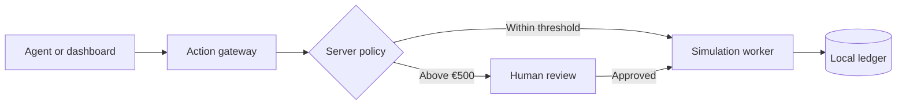
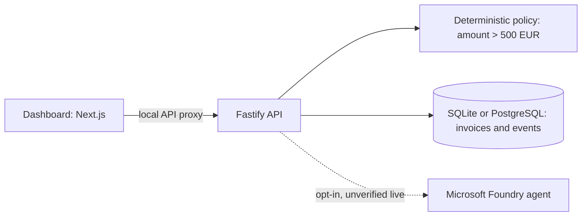

  

<h1 align="center">Martenwatch</h1>

<strong>A checkpoint for agent actions.</strong>

An experimental action ledger for simulated invoices, human review, and recovery.

  <a href="#how-it-works">How it works</a> ·
  <a href="#run-locally">Get started</a> ·
  <a href="#evidence-and-limits">Evidence &amp; limits</a> ·
  <a href="docs/ARCHITECTURE.md">Architecture</a> ·
  <a href="SECURITY.md">Security</a>

  

> [!WARNING]
> **Local research prototype.** Use synthetic data only. The default demo has no real authentication; do not expose it to the internet or use it for actual payments.

Martenwatch (previously ActionLedger ONE) explores a narrow question: **what happens when an agent requests an action that requires human approval?** A deterministic backend checks a simulated invoice before a worker records a simulated effect. Amounts strictly above **€500** require review; exactly €500 does not. No money moves.

| Agent tools | Human review | Recovery lab | Evidence |
| --- | --- | --- | --- |
| Local MCP and SDK experiments route simulated tool calls through a gateway. | The server independently checks the invoice state. | Tests exercise process interruption, retries, and parallel local workers. | Local events, traces, security datasets, and reproducible tests show what happened. |

## How it works

1. **Propose:** create a synthetic invoice and request a simulated action.
2. **Check:** the server evaluates the amount and blocks actions awaiting review.
3. **Review:** an approval or rejection changes the simulated workflow state.
4. **Record:** the local ledger records the result; recovery tests exercise interrupted work.

## Evidence and limits

- **Implemented locally:** invoice gating, simulated effects, SQLite persistence, a PostgreSQL prototype, local MCP tests, offline SDK tests, recovery experiments and OpenTelemetry traces.
- **Tested in GitHub Actions:** CI, a disposable PostgreSQL service, Docker smoke test, dependency audit, CodeQL and a secret scan. Check [Actions](../../actions) for the current commit; historical failures remain visible.
- **Experimental only:** Foundry has not been tested with a live model from the application. AWS Bedrock is a mock contract and the Databricks SQL contains synthetic rows only. There is no live cloud integration or real cost monitoring.
- **Not production security:** reviewer identity is not authenticated in the default app, event logs are mutable, isolation is not production-ready, and external exactly-once payments are not guaranteed. See [security boundaries](docs/SECURITY.md).

Details: [security benchmark](benchmark/README.md) · [reliability lab](docs/RELIABILITY-LAB.md) · [local tracing](docs/EVALUATION-TRACING.md) · [MCP and agent experiment](docs/OPENAI-AGENT.md) · [performance methodology](benchmark/PERFORMANCE.md).

## Run locally

Requires Node.js 24 or newer and npm. From this directory, run `npm ci`. Start the API with `npm run api`; in a second terminal run `npm run dev`, then open http://localhost:3000. Run `npm test` for policy and API tests. The API binds only to `127.0.0.1:4000`. Local demo data is stored under `data/`, which is excluded from Git.

On the development machine the native Next.js Windows compiler failed to load. The build was verified using the installed WASM package: in PowerShell set `$env:NEXT_TEST_WASM_DIR = (Resolve-Path 'node_modules\@next\swc-wasm-nodejs').Path`, then run `npm run build`. This is an internal Next.js test flag, not a portable deployment solution.

### Docker quickstart (local only)

With Docker Engine and the Compose plugin installed, run `docker compose up --build` and open `http://127.0.0.1:3000`. Stop with `docker compose down`; the named `ledger-data` volume retains the synthetic local ledger. `docker compose down -v` removes that volume and its demo data. The compose port is bound to host loopback. A GitHub Actions runner has built and smoke-tested the container; it has not been tested on every local machine. Do not expose the dashboard publicly.

## Design

Amounts are represented as integer cents. The server evaluates the threshold independently of the UI or model. Invoice creation and its event, and approval decisions and their events, are written in SQLite transactions. A decision is accepted only while an invoice is awaiting review. Tests cover the threshold, invalid inputs, repeat decisions, audit events and persistence across restart.

The recovery engine tracks queued, running and completed simulated jobs. On startup, running jobs are requeued and processed. The SQLite worker checks the invoice status again immediately before producing an effect; tests also inject an unauthorized queue entry and verify that restart cannot bypass review. A unique simulated effect per invoice makes replay safe **within this simulated ledger**. This does not provide exactly-once execution against a real payment system; that would require an external idempotency key and reconciliation. `POST /api/invoices/:id/simulate` refuses invoices awaiting approval. One test kills a local worker after it claims a job and verifies recovery after restart. Run only one API instance: startup recovery is not coordinated across replicas.

In SQLite mode, `GET /api/telemetry` exposes locally generated OpenTelemetry request, model-call, security-decision and recovery spans plus request, latency, model-call, token and security counters/histograms. Process CPU time and RSS/heap memory are measured locally. Up to 200 completed spans are held in process memory; no cloud exporter is configured, and data resets on restart. Prompt text, invoice data, credentials and model response text are excluded from telemetry. Tests verify trace correlation and error/block reporting. The dashboard shows a small local summary. Model tokens appear only when a provider returns usage; model prices are not estimated. PostgreSQL mode does not yet instrument OpenTelemetry.

### Agent Security Lab

`tests/security-lab.test.mjs` exercises malicious instructions in simulated input and provider output, forged role hints, missing identity, forbidden roles, protected reads, and attempted execution before review. These are deterministic offline tests of the gateway, **not a live LLM prompt-injection benchmark**. The tests enable a simulated identity adapter with `requireIdentity: true`; the normal local demo deliberately has no authentication. In this test mode routes use a deny-by-default permission mapping, but the adapter is not a real identity provider and must not be used as production authorization. Never expose the local demo publicly.

`tests/tenant-lab.test.mjs` verifies cross-tenant read and action denial in an isolated offline test harness with separate stores and fake identities. It does **not** provide production tenant isolation to the application. See [security model](docs/SECURITY.md) and [operations guide](docs/OPERATIONS.md).

### Reliability tests

In addition to the synthetic benchmark, `tests/recovery.test.mjs` kills a real worker process after it claims a job and verifies recovery on restart. Another test starts four independent local worker processes to drain 30 jobs, repeats enqueue requests, and checks that every job, effect, and completion event occurs once. This covers the SQLite simulation with a single recovery coordinator, not concurrent API startups, PostgreSQL replica coordination, distributed failures, or exactly-once external payments.

### Optional Foundry and PostgreSQL configuration

Foundry is disabled by default, even if an endpoint is configured. The opt-in and Azure prerequisites are described in [the Foundry guide](docs/FOUNDRY.md). A future live call may cost money and must be authorized separately; no real model call has been validated. The output is advisory and cannot override the deterministic policy.

Set `DATABASE_URL` to use PostgreSQL instead of SQLite. Use TLS with certificate verification for Azure. The PostgreSQL path creates its initial tables on startup; it is an initial prototype rather than a versioned migration system. The test `tests/postgres.test.mjs` runs only when `TEST_DATABASE_URL` points to a disposable PostgreSQL database. It passed against PostgreSQL 16 in GitHub Actions, but Azure PostgreSQL has not been tested.

Run `npm run benchmark` for 100 isolated synthetic actions: 25 blocked high-value requests and 75 completed simulations, with 10 artificially interrupted job states replayed. This tests recovery of persisted state, not an actual process kill, concurrent load, cloud availability or external payment behavior. CI is defined in `.github/workflows/ci.yml`; the [GitHub Actions run](https://github.com/m4z8p6fy9m-coder/actionledger-one/actions/runs/41524681622) passed tests, PostgreSQL integration, the synthetic benchmark, build and Docker smoke test. `docker compose up --build` runs the local demo on loopback with a persistent Docker volume; it is not a production deployment.

## Security and scope

- Synthetic data only. Approval actions are unauthenticated in this local prototype; audit events do not establish a verified human identity and are not tamper-proof.
- Default storage is local SQLite, **not Azure PostgreSQL**. PostgreSQL has been tested in CI, not against Azure; Foundry's live model integration remains unverified. There is no Azure deployment, model cost telemetry or real identity-based access control. Local OpenTelemetry currently covers the SQLite API path only. AWS is not integrated.
- There is no payment or financial-system integration. `processed` denotes a simulated workflow state.
- Do not use with real invoices or expose the API or dashboard publicly. A deployable version needs authentication and authorization, CSRF protections, durable PostgreSQL transactions, identity-attributed audit records, secret management and operational monitoring.

## Next milestones

1. Add authenticated reviewers and authorization checks, with adversarial tests.
2. Add versioned PostgreSQL migrations and test the adapter against Azure only with explicit budget controls.
3. Verify the Foundry agent with managed identity against the actual project; treat model output as untrusted and never let it bypass the server policy.
4. Add container deployment, budget-aware configuration, CI, monitoring and a reproducible Azure deployment guide.

Security evaluation: see [benchmark methodology and reproducible datasets](benchmark/README.md).

OpenAI Agents SDK offline integration and comparison: [documentation](docs/OPENAI-AGENT.md).

Reliability challenge lab: [scenarios, results and safety limits](docs/RELIABILITY-LAB.md).

Local measured performance and raw data: [benchmark protocol](benchmark/PERFORMANCE.md) and [report](benchmark/results/local-sanitized/REPORT.md).

Local evaluations and structured workflow traces: [documentation](docs/EVALUATION-TRACING.md).

Research showcase: run `npm run demo:showcase` for the offline SDK and approval demo; see [article draft](showcase/TECHNICAL-ARTICLE.md), [recording plan](showcase/DEMO-SCRIPT.md) and [community drafts](showcase/COMMUNITY-DRAFTS.md).
