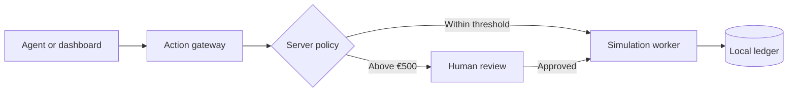

<p align="center"></p>
<h1 align="center">Martenwatch</h1>
<h3 align="center">A checkpoint for agent actions.</h3>
<p align="center">An experimental action ledger for simulated invoices, human review, and recovery.<br />A small system for exploring what an agent can request—and what the server must decide.</p>
<p align="center">  </p>
<p align="center"><a href="#how-it-works">How it works</a> · <a href="#get-started">Get started</a> · <a href="#run-the-labs">Run the labs</a> · <a href="#status-and-limits">Status &amp; limits</a> · <a href="docs/ARCHITECTURE.md">Architecture</a></p>

> [!WARNING]
> **Local research prototype.** Use synthetic data only. The default demo has no real authentication or production tenant isolation. Do not expose it to the internet or use it for actual payments.

Martenwatch (previously ActionLedger ONE) explores a narrow question: **what happens when an agent requests an action that needs human approval?** The server checks a simulated invoice before a worker records a simulated effect. Amounts **over €500** require review; exactly €500 does not. No money moves.

| Tool requests | Human review | Recovery | Evidence |
| --- | --- | --- | --- |
| Local MCP and SDK experiments send simulated requests through a gateway. | A server-side rule checks the invoice independently of model output. | Local tests exercise interrupted processes, retries and parallel workers. | Events, traces and reproducible experiments show what the prototype did. |

<p align="center"></p>

## How it works

1. **Propose:** create a synthetic invoice and request a simulated action.
2. **Check:** the server applies the amount rule and blocks requests awaiting review.
3. **Review:** approve or reject the simulated invoice when a decision is needed.
4. **Record:** the local ledger records the simulated result; recovery tests exercise interrupted work.



The reviewer in the default demo is not authenticated. The rule is enforced in the local simulation; it is not a production authorization system.

## Get started

**You need:** Node.js 24 or newer and npm. Docker Engine and Compose are optional. Use only a local machine and synthetic data.

```sh
npm ci
npm run api
```

In a second terminal:

```sh
npm run dev
```

Open **http://localhost:3000**. The API binds to `127.0.0.1:4000`; SQLite demo data is stored in the ignored `data/` directory.

<details>
<summary><strong>Run with Docker Compose instead</strong></summary>

```sh
docker compose up --build
```

Open http://127.0.0.1:3000. `docker compose down` stops the containers; the named volume retains demo data. Adding `-v` deletes that volume and its contents. The dashboard port is bound to host loopback. A GitHub Actions runner builds and smoke-tests this setup; it is not a production deployment.

</details>

The project commands disable Next.js developer telemetry. Direct Next.js CLI calls bypass the wrapper; set `NEXT_TELEMETRY_DISABLED=1` yourself. This does not control telemetry from unrelated tools or hosting. See [privacy design](docs/PRIVACY-DESIGN.md).

## Run the labs

| What to inspect | Command | What it covers |
| --- | --- | --- |
| Test suite | `npm test` | Policy, simulated actions, MCP, recovery and local security tests. |
| Agent tool boundary | `node --test tests/mcp.test.mjs tests/tool-gateway.test.mjs` | Local MCP calls, approval enforcement and simulated effects. |
| Recovery | `npm run lab:reliability` | Worker interruption, parallel local processes and simulated provider failures. |
| Security dataset | `npm run benchmark:security -- holdout` | Synthetic cases against the local gateway; not a live model evaluation. |
| Offline SDK demo | `npm run demo:showcase` | Scripted agent and simulated approval flow; no external model call. |

PostgreSQL tests require `TEST_DATABASE_URL` pointing to a **disposable** PostgreSQL database. They run against PostgreSQL 16 in GitHub Actions. Local process/network tests need loopback access. See the [evaluation guide](docs/EVALUATION-TRACING.md) and [benchmark methodology](benchmark/README.md).

## Status and limits

| Area | Current state |
| --- | --- |
| **Actions and review** | Simulated invoices, local policy checks and reviewer decisions. Default demo decisions are unauthenticated. |
| **Storage and recovery** | SQLite locally; PostgreSQL prototype integration-tested in CI. Recovery is a single-coordinator simulation, not exactly-once external payment execution. |
| **Agents and MCP** | MCP client/server and OpenAI SDK experiments run locally with test identities. Foundry adapter is opt-in and has not been validated with a live model from this application. |
| **Observability** | Bounded in-memory OpenTelemetry traces and metrics on the SQLite API path. Durable workflow events are mutable and are not a tamper-proof audit trail. |
| **Other clouds** | Bedrock is a mock contract; Databricks SQL uses synthetic rows. Neither is a live cloud connection or cost-monitoring service. |
| **Privacy** | Local demo notices and a voluntary age-group choice are prototypes, not age verification or a complete public-service privacy policy. Per-user isolation is not implemented. |

GitHub Actions runs the test suite, PostgreSQL integration, dependency audit, Docker smoke test, CodeQL and a secret scan. See the [Actions tab](../../actions) for the current commit. Passing scans and tests do not prove the system is secure.

## Under the hood

The dashboard uses Next.js and the API uses Fastify. Amounts are integer cents. SQLite stores invoice states, decisions and events; the worker rechecks eligibility before recording a simulated effect. A unique simulated effect per invoice makes replay safe **within this local ledger only**. Run one API instance: startup recovery is not coordinated across replicas.

Foundry is disabled by default. A future live call can cost money and requires an authorized configuration and explicit opt-in; model output cannot override the server policy. The [Foundry guide](docs/FOUNDRY.md) documents the unverified adapter. PostgreSQL has no OpenTelemetry instrumentation in this prototype and requires versioned migrations before production.

<details>
<summary><strong>Windows build note</strong></summary>

On the development machine the native Next.js Windows compiler failed to load. A build was verified with the installed WASM package: in PowerShell set `$env:NEXT_TEST_WASM_DIR = (Resolve-Path 'node_modules\@next\swc-wasm-nodejs').Path`, then run `npm run build`. This is an internal Next.js test flag, not a portable deployment solution.

</details>

## Read more

- [Architecture](docs/ARCHITECTURE.md) · [Security model](docs/SECURITY.md) · [Security policy](SECURITY.md)
- [Reliability lab](docs/RELIABILITY-LAB.md) · [Evaluations and tracing](docs/EVALUATION-TRACING.md) · [Performance methodology](benchmark/PERFORMANCE.md)
- [MCP and agent experiments](docs/OPENAI-AGENT.md) · [Foundry](docs/FOUNDRY.md) · [Multicloud experiments](docs/MULTICLOUD.md)
- [Privacy design](docs/PRIVACY-DESIGN.md) · [Demo script](showcase/DEMO-SCRIPT.md) · [Technical article draft](showcase/TECHNICAL-ARTICLE.md)

## License

[MIT](LICENSE). Martenwatch is an educational prototype; no production-security or compliance certification is implied.
