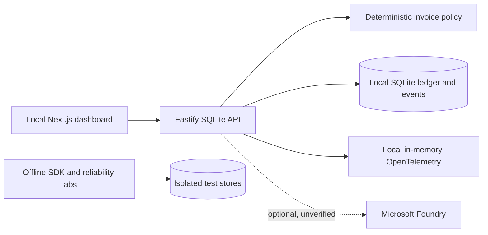

# Architecture and deployment boundary

This prototype uses synthetic invoices, a server-side threshold strictly above EUR 500 and simulated effects. The local policy is authoritative over advisory model text. Fastify handles state, and SQLite stores invoice states, approvals and local event records. Recovery is limited to single-coordinator local simulated effects; external non-idempotent services need reconciliation. No real payment integration exists. PostgreSQL passed a disposable-service CI integration test; Foundry has not been validated against a live model. PostgreSQL lacks some SQLite tracing and security features; neither adapter is a production-ready deployment.

The Docker Compose quickstart is a local-only demonstration. The API binds to loopback within the container, and Compose binds the dashboard to host loopback. This does not provide real reviewer authentication, tenant separation, CSRF protection, immutable audit or production hardening. The application is not approved for public hosting. See the [security model](SECURITY.md), [evaluation and tracing](EVALUATION-TRACING.md), [reliability lab](RELIABILITY-LAB.md), and [benchmark methodology](../benchmark/PERFORMANCE.md).

GitHub workflows run PostgreSQL integration tests, dependency audit, CodeQL, secret scanning, build and Docker smoke tests. The first GitHub Actions CI and secret scan have passed. Check the repository Actions page for current CodeQL and later-run status. GitHub feature availability, free allowances, repository visibility and settings must be checked before enabling workflows; do not buy or upgrade anything without the owner's authorization. There is no automated deployment to a public service.
